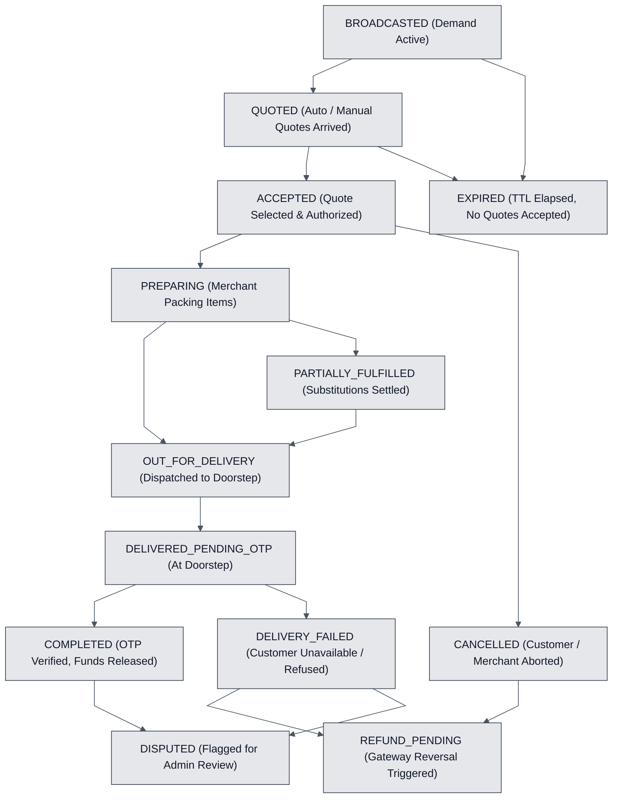
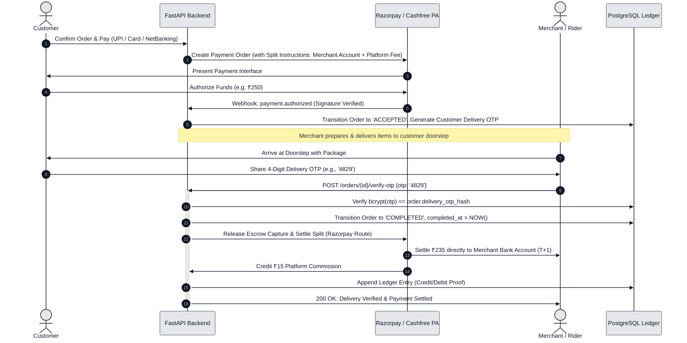
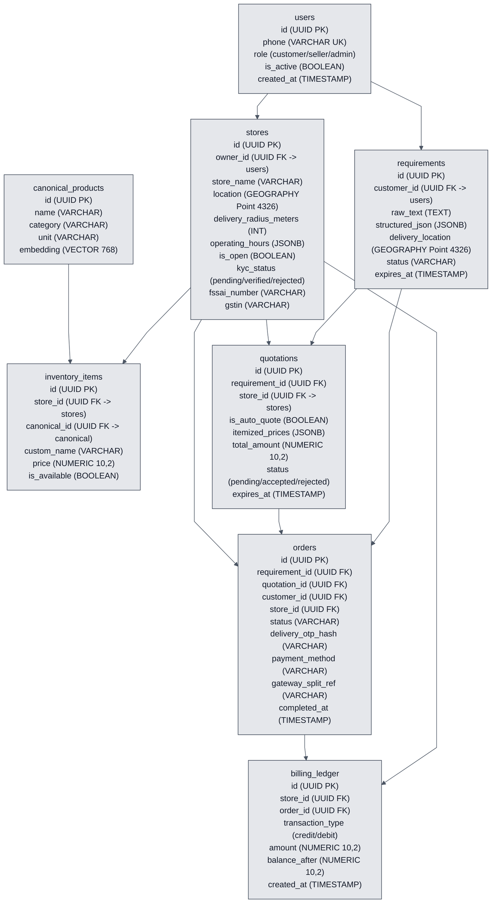
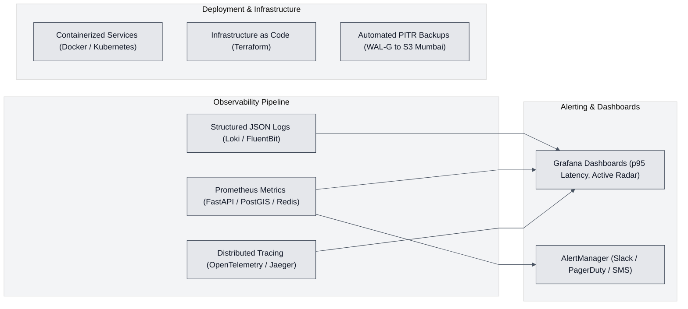

# System Architecture v2: Production-Hardened Hyperlocal Reverse-Marketplace

## 1. Executive Summary & Architectural Evolution

This document presents the **Production-Hardened System Architecture (v2)** for the Hyperlocal Reverse-Marketplace. Based on architectural review and real-world commercial viability assessments, this revision resolves critical production gaps across:

1. **Zero-Trust Security & Identity**: Eliminates client-supplied identity parameters (`customer_id`, `seller_id`) in favor of Phone OTP authentication, short-lived signed JWT bearer tokens, and server-side identity derivation with strict row-level security.
2. **Atomic & Concurrency-Safe State Transactions**: Enforces row-level pessimistic locking (`SELECT ... FOR UPDATE`) and atomic multi-row updates strictly scoped to the targeted requirement (`WHERE requirement_id = :rid AND id != :qid`).
3. **Regulatory-Compliant Payment Split-Settlement & Delivery OTP**: Replaces custom unregulated marketplace escrow with licensed Payment Aggregator (PA) split-settlement (e.g., Razorpay Route / Cashfree), adds Cash on Delivery (COD), mandates 4-digit customer doorstep delivery OTP before fund release, and enforces append-only ledger accounting.
4. **Latency Elimination via Hybrid Auto-Quoting**: Solves the reverse-auction latency dilemma by auto-generating instant price quotes from matching in-stock `inventory_items` within 500 ms, while allowing merchants a 1-tap approval or override.
5. **Decoupled Asynchronous Event-Driven Pipeline**: Converts synchronous LLM parsing into an asynchronous `202 Accepted` queue workflow backed by Redis and background task workers, replacing polling with Firebase Cloud Messaging (FCM) and WebSockets.
6. **DPDP Act 2023 & Indian E-Commerce Compliance**: Incorporates explicit consent, purpose limitation, customer location/phone masking prior to order confirmation, FSSAI/GSTIN verification, and Grievance Officer registration.

---

## 2. Comprehensive System Architecture Diagram (v2)

```mermaid
%%{init: {'theme': 'base', 'themeVariables': { 'primaryColor': '#e5e7eb', 'primaryBorderColor': '#374151', 'primaryTextColor': '#111827', 'lineColor': '#4b5563', 'edgeLabelBackground':'#ffffff', 'tertiaryColor': '#f3f4f6'}, 'flowchart': {'curve': 'linear'}}}%%
flowchart TB

    subgraph CLIENT_TIER["1. CLIENT TIER (Mobile-First & PWA)"]
        direction TB
        C_MOB["Customer Mobile App (React Native / Expo)"]
        C_WEB["Customer Web Portal (React / Tailwind PWA)"]
        S_MOB["Seller Merchant App (React Native / Expo with Push)"]
        S_WEB["Seller Web Dashboard (React / Tailwind PWA)"]
        A_WEB["Admin & Dispute Console (React / Tailwind)"]
    end

    subgraph INGRESS_TIER["2. EDGE, SECURITY & INGRESS TIER"]
        direction TB
        WAF_LB["Reverse Proxy, Rate Limiter & SSL Termination (Nginx / Cloudflare)"]
        AUTH_SVC["Auth Service (Phone OTP, JWT Bearer Token Issuer & Validator)"]
        PROMPT_GUARD["LLM Prompt Injection Sanitizer & Input Guardrail"]
    end

    subgraph ASYNC_TIER["3. MESSAGE BROKER & ASYNC TASK QUEUE"]
        direction TB
        REDIS_BUS["Redis 7 (Pub/Sub Event Bus & Task Queue)"]
        TASK_WORKERS["Background Task Workers (Asynchronous NLP & Matching)"]
        PUSH_DISPATCH["Push Dispatcher (FCM / WebSockets / WhatsApp Service)"]
    end

    subgraph APP_TIER["4. APPLICATION SERVER TIER (FastAPI)"]
        direction TB
        API_GATEWAY["FastAPI Application Services"]
        
        subgraph MODULES["Modular Domain Services"]
            direction LR
            REQ_SVC["Requirement Service"]
            AI_SVC["AI Semantic Parser (Configurable Models + Cache)"]
            MATCH_SVC["Geospatial Matching Engine (PostGIS Geography)"]
            AUTO_QUOTE["Instant Auto-Quotation Engine"]
            ORDER_SVC["Order State Machine & Delivery OTP Service"]
            LEDGER_SVC["Append-Only Billing & Quota Ledger"]
        end
    end

    subgraph STORAGE_TIER["5. PERSISTENCE & CACHE TIER (PostgreSQL 16 Enterprise)"]
        direction TB
        subgraph EXTENSIONS["PostgreSQL Engine Extensions"]
            direction LR
            POSTGIS_GEO["PostGIS (Native Geography Columns & GiST Spatial Indexes)"]
            PGVECTOR_EMB["pgvector (Catalog Product Embeddings & Semantic Search)"]
        end
        subgraph RELATIONAL_TABLES["Relational, Ledger & Audit Tables"]
            direction LR
            TBL_USERS["users (Auth, Phone, KYC, Role)"]
            TBL_STORES["stores (Location, Radius, Operating Hours, GST/FSSAI)"]
            TBL_CANONICAL["canonical_products (Embeddings, Categories)"]
            TBL_REQ["requirements (Status, Expiry, Location)"]
            TBL_QUOTES["quotations (Auto/Manual Flag, TTL, Prices)"]
            TBL_ORDERS["orders (Full State Machine, OTP Hash, Split Ref)"]
            TBL_LEDGER["billing_ledger (Append-Only Transactions)"]
            TBL_AUDIT["audit_logs & disputes (Dispute Evidence, Logs)"]
        end
    end

    subgraph EXTERNAL_TIER["6. EXTERNAL SERVICES & PARTNERS"]
        direction TB
        EXT_LLM["LLM Provider (Primary Gemini / OpenAI, Secondary Claude)"]
        EXT_PAY["Licensed Payment Aggregator (Razorpay Route / Cashfree Split)"]
        EXT_COMM["Communication Gateways (Gupshup SMS / WhatsApp / FCM)"]
        EXT_LOGISTICS["3PL Hyperlocal Logistics (Shadowfax / Porter / Dunzo API)"]
        EXT_ONDC["ONDC Hyperlocal Gateway (Open Network Interoperability)"]
    end

    %% Client to Ingress (Solid Lines)
    C_MOB --> WAF_LB
    C_WEB --> WAF_LB
    S_MOB --> WAF_LB
    S_WEB --> WAF_LB
    A_WEB --> WAF_LB

    %% Ingress to Auth & App (Solid Lines)
    WAF_LB --> AUTH_SVC
    WAF_LB --> PROMPT_GUARD
    PROMPT_GUARD --> API_GATEWAY

    %% App to Async Tier (Solid Lines)
    API_GATEWAY --> REDIS_BUS
    REDIS_BUS --> TASK_WORKERS
    TASK_WORKERS --> PUSH_DISPATCH
    PUSH_DISPATCH --> S_MOB
    PUSH_DISPATCH --> C_MOB

    %% Gateway to Modules (Solid Lines)
    API_GATEWAY --> REQ_SVC
    API_GATEWAY --> AI_SVC
    API_GATEWAY --> MATCH_SVC
    API_GATEWAY --> AUTO_QUOTE
    API_GATEWAY --> ORDER_SVC
    API_GATEWAY --> LEDGER_SVC

    %% Modules to Storage (Solid Lines)
    MATCH_SVC --> POSTGIS_GEO
    MATCH_SVC --> TBL_STORES
    AI_SVC --> PGVECTOR_EMB
    AI_SVC --> TBL_CANONICAL
    AUTO_QUOTE --> TBL_CANONICAL
    ORDER_SVC --> TBL_ORDERS
    ORDER_SVC --> TBL_QUOTES
    LEDGER_SVC --> TBL_LEDGER

    %% Services to External (Solid Lines)
    TASK_WORKERS --> EXT_LLM
    ORDER_SVC --> EXT_PAY
    PUSH_DISPATCH --> EXT_COMM
    ORDER_SVC --> EXT_LOGISTICS
    API_GATEWAY --> EXT_ONDC
```



---

## 3. High-Velocity Asynchronous Request & Auto-Quote Pipeline

To compete effectively with modern quick-commerce platforms, customer waiting time is minimized using an **asynchronous request pipeline with inventory auto-quoting**:


### End-to-End Execution Stages:

1. **Asynchronous Ingestion (HTTP 202 Accepted)**:
   * The customer posts their unstructured list and coordinates to `POST /api/v1/requirements`.
   * The API derives the authenticated `customer_id` from the validated JWT bearer token.
   * Rather than holding an open HTTP socket for up to 10 seconds while calling an LLM, the API saves the raw requirement with `status = 'PENDING_PARSING'`, dispatches an event to the Redis task queue, and immediately returns `HTTP 202 Accepted` with a tracking task ID.

2. **Semantic Extraction & Multilingual NLP**:
   * A background task worker picks up the job.
   * The text is sanitized against prompt-injection vectors and passed to the primary LLM (with configured timeouts of 4 seconds).
   * Supports English, Hinglish, Hindi, and Marathi terminology (e.g., *"2 packet pav, arhar daal 1 kg, kothimbir"*).
   * Items are mapped against `canonical_products` using **pgvector cosine embeddings** (`<=>`) to resolve brand, size, and sub-varieties.
   * A confidence score is attached. If low, a flag `requires_confirmation = true` is set.

3. **Customer Review & Disambiguation**:
   * Via WebSocket / Server-Sent Events (SSE), the customer app receives the structured shopping list.
   * The customer confirms quantities and substitutes with a single tap.

4. **Instant Auto-Quotation from Local Inventories**:
   * The geospatial matching engine identifies all open, active, KYC-verified stores within 3 km using native `geography` distance queries on `stores.location`.
   * For stores with cataloged prices in `inventory_items`, an **Auto-Quote** is generated immediately.
   * The customer sees initial pricing within seconds rather than waiting minutes for shopkeepers to manually type numbers.

5. **Merchant Real-Time Radar & One-Tap Action**:
   * In-radius merchants receive a high-priority push notification (via Firebase Cloud Messaging) and an active card on their dashboard radar.
   * If an auto-quote was generated, the merchant can accept it with 1 tap or override individual line prices/substitutions.
   * Stores without pre-cataloged items can submit a manual quote before the requirement's expiration TTL (e.g., 10 minutes).

---

## 4. Comprehensive Order Lifecycle State Machine

The order lifecycle handles real-world commerce edge cases, including timeouts, delivery OTP verification, cancellations, partial fulfillment, and payment reconciliations.



### State Transition & Invariant Rules:

| State | Allowed Next States | Trigger / Condition | Financial & Inventory Impact |
|---|---|---|---|
| `BROADCASTED` | `QUOTED`, `EXPIRED`, `CANCELLED` | Customer broadcasts requirement. Expiration TTL starts (10 mins). | No funds held. |
| `QUOTED` | `ACCEPTED`, `EXPIRED`, `CANCELLED` | At least 1 valid auto or manual quote received before expiry. | No funds held. |
| `ACCEPTED` | `PREPARING`, `CANCELLED` | Customer selects quote. Payment authorized (Escrow hold) or COD confirmed. | Funds held in escrow via Razorpay Route / Cashfree. |
| `PREPARING` | `OUT_FOR_DELIVERY`, `PARTIALLY_FULFILLED`, `CANCELLED` | Merchant begins packing order. | Inventory committed. |
| `PARTIALLY_FULFILLED` | `OUT_FOR_DELIVERY`, `CANCELLED` | Merchant flags out-of-stock item; customer accepts price adjustment. | Partial refund queued for unfulfilled items. |
| `OUT_FOR_DELIVERY` | `DELIVERED_PENDING_OTP`, `DELIVERY_FAILED` | Order handed over to rider (merchant self-delivery or 3PL partner). | Delivery tracking active. Customer receives 4-digit OTP. |
| `DELIVERED_PENDING_OTP`| `COMPLETED`, `DELIVERY_FAILED` | Rider arrives at customer doorstep. | Rider requests OTP from customer. |
| `COMPLETED` | `DISPUTED` | Rider enters matching 4-digit OTP. Verified on server. | Escrow split released to merchant account; commission credited; ledger updated. |
| `EXPIRED` | *Terminal* | Expiration timer triggers without quote acceptance. | Requirement closed; no liability. |
| `CANCELLED` | `REFUND_PENDING`, *Terminal* | Customer cancels before dispatch or seller declines order. | Full authorization reversal triggered via payment gateway. |
| `DELIVERY_FAILED` | `REFUND_PENDING`, `DISPUTED` | Customer absent at address or refuses delivery. | Reverse logistics initiated; dispute ticket created. |
| `REFUND_PENDING` | *Terminal* | Payment gateway webhook confirms reversal to customer account. | Ledger updated with refund debit. |
| `DISPUTED` | *Terminal (Resolved)* | Customer or merchant raises dispute within 24 hours. | Operations team reviews GPS audit logs and delivery proofs. |

---

## 5. Security, Identity & Transaction Safety

### 5.1 Zero-Trust Authentication & Authorization Architecture
1. **Phone Number OTP Login**:
   * Users authenticate via mobile number and SMS OTP.
   * Passwords are not used, aligning with Indian consumer norms.
   * OTP endpoints are protected with rate limiting (max 3 requests per 10 minutes per IP/phone) and captcha triggers for abnormal traffic.
2. **Server-Side Identity Derivation**:
   * The authentication service signs a cryptographically secure JWT containing `user_id`, `role` (`customer`, `seller`, `admin`), and `store_id` (if seller).
   * **Rule**: Client HTTP requests **never** pass `customer_id` or `seller_id` in request bodies or query parameters.
   * The FastAPI dependency `get_current_user` extracts and validates the token from the `Authorization: Bearer <token>` header, enforcing tenant isolation on every database query.

### 5.2 Safe Atomic Quote Acceptance (Concurrence-Safe Transaction)
The quote acceptance operation executes within a strict database transaction with pessimistic row-locking (`SELECT ... FOR UPDATE`) to eliminate race conditions and avoid cross-requirement quote rejections:

```python
async def accept_quotation_atomically(
    db: AsyncSession,
    requirement_id: UUID,
    quotation_id: UUID,
    customer_id: UUID,
    payment_method: str
) -> Order:
    async with db.begin():
        # 1. Lock the requirement row for the requesting customer
        stmt = (
            select(Requirement)
            .where(
                Requirement.id == requirement_id,
                Requirement.customer_id == customer_id,
                Requirement.status.in_(["BROADCASTED", "QUOTED"])
            )
            .with_for_update()
        )
        req = (await db.execute(stmt)).scalar_one_or_none()
        if not req:
            raise HTTPException(400, "Requirement not found or already accepted/closed")

        # 2. Lock the specific quotation being accepted
        quote_stmt = (
            select(Quotation)
            .where(
                Quotation.id == quotation_id,
                Quotation.requirement_id == requirement_id,
                Quotation.status == "pending"
            )
            .with_for_update()
        )
        selected_quote = (await db.execute(quote_stmt)).scalar_one_or_none()
        if not selected_quote:
            raise HTTPException(400, "Quotation invalid, expired, or already processed")

        # 3. Mark selected quote accepted
        selected_quote.status = "accepted"

        # 4. Strictly scope rejection to other quotes for THIS requirement only
        reject_stmt = (
            update(Quotation)
            .where(
                Quotation.requirement_id == requirement_id,
                Quotation.id != quotation_id,
                Quotation.status == "pending"
            )
            .values(status="rejected")
        )
        await db.execute(reject_stmt)

        # 5. Transition requirement state
        req.status = "ACCEPTED"

        # 6. Generate 4-digit delivery OTP hash
        delivery_otp = generate_secure_4digit_otp()
        otp_hash = hash_delivery_otp(delivery_otp)

        # 7. Create confirmed order
        order = Order(
            requirement_id=requirement_id,
            quotation_id=quotation_id,
            customer_id=customer_id,
            seller_id=selected_quote.seller_id,
            total_amount=selected_quote.total_amount,
            status="ACCEPTED",
            payment_method=payment_method,
            delivery_otp_hash=otp_hash
        )
        db.add(order)
        
        # 8. Record audit entry in billing ledger
        # Transaction commits atomically upon exiting context block
        return order
```

---

## 6. Payment Architecture, Licensed Split-Settlement & Delivery OTP

### 6.1 Regulatory Compliance with Reserve Bank of India (RBI) Guidelines
Marketplaces cannot hold customer funds directly in corporate bank accounts without a Payment Aggregator (PA) license from the RBI. The platform uses a **Licensed Payment Aggregator Split-Settlement Integration** (e.g., Razorpay Route or Cashfree Marketplace Settlement):



### 6.2 Cash on Delivery (COD) Workflow
1. For COD orders, payment status is marked `PENDING_COD`.
2. The customer provides the delivery OTP to the delivery agent **only after handing over cash**.
3. When the delivery agent submits the OTP, the order marks `COMPLETED`, and the agent's collected cash ledger increments.

### 6.3 Idempotency, Reconciliation & Ledger
* All payment and settlement API endpoints require an `Idempotency-Key` HTTP header.
* Webhook handlers verify cryptographic HMAC-SHA256 signatures before executing database operations.
* A daily cron job executes automated two-way financial reconciliation comparing gateway settlement reports against the internal `billing_ledger` table.

---

## 7. Revised Entity-Relationship Data Model

The data model separates individual user accounts from physical store establishments, adopts native PostGIS `geography` types, and integrates append-only ledger accounting.



### Key Schema Enhancements:
1. **Separation of `users` and `stores`**: Allows a merchant to own a store, update store operational hours, toggle `is_open`, and register verified tax/compliance credentials (`fssai_number`, `gstin`) independently of user identity.
2. **Native `GEOGRAPHY(Point, 4326)` Columns**: Replaces `geometry` casts with native PostGIS spherical geography columns for `stores.location` and `requirements.delivery_location`. Enables native GiST spatial indexes without inline type conversion overhead.
3. **Canonical Product Embeddings (`pgvector`)**: Stores standard item embeddings (768-dimensional vectors from open-source embedding models) for instantaneous fuzzy item resolution.
4. **Append-Only `billing_ledger`**: Eliminates mutable integer counters on user tables. Merchant order counts, platform fees, and escrow splits are derived from immutable ledger rows.

---

## 8. Compliance, Privacy & India DPDP Act 2023 Framework

Operating a hyperlocal delivery marketplace in India involves strict legal and regulatory mandates:

### 8.1 Digital Personal Data Protection (DPDP) Act 2023
* **Consent Architecture**: Customers must provide explicit, itemized consent during registration for phone verification and location processing.
* **Purpose Limitation & Pre-Acceptance Privacy Masking**:
  * Prior to order acceptance by the customer, nearby merchants on the radar view only an **approximate 500-meter radius geohash** and parsed grocery items.
  * The customer's exact delivery address and phone number are **strictly masked** until the customer accepts a specific vendor's quote.
* **Data Erasure & Portability**: Users can request complete profile anonymization and deletion of location history.
* **Data Localization**: All production databases, Redis instances, and storage volumes are hosted strictly within India (e.g., AWS Asia Pacific `ap-south-1` Mumbai or GCP `asia-south1`).

### 8.2 Food Safety & E-Commerce Regulations
* **FSSAI Compliance**: Grocery and food product sellers must supply a verified 14-digit FSSAI license number prior to receiving broadcasts.
* **GSTIN Verification**: Stores claiming commercial registration are verified against the GST portal API.
* **Grievance Redressal**: A designated Grievance Officer's contact details and escalation matrix are published in compliance with the Consumer Protection (E-Commerce) Rules, 2020.

---

## 9. Operations, Reliability & Production Observability



### 9.1 Observability Standards
* **Prometheus Metrics**: Exports `http_request_duration_seconds` (p50, p95, p99), `active_broadcasts_count`, `postgis_query_duration_seconds`, and `llm_fallback_ratio`.
* **Distributed Tracing**: OpenTelemetry instrumentation traces the lifecycle of a request from client dispatch, through the Redis task worker, LLM client, and PostGIS matching engine.
* **Structured Logging**: Standard JSON format with `request_id`, `user_id`, and `duration_ms` for automated parsing.

### 9.2 Reliability, Backups & Disaster Recovery
* **Point-in-Time Recovery (PITR)**: Continuous PostgreSQL WAL archiving via `pg_dump` and continuous WAL shipping to S3-compatible encrypted storage in Mumbai.
* **Read Replicas**: The PostGIS database is configured with an asynchronous read replica for heavy spatial queries (`ST_DWithin`) and catalog searches, isolating write traffic on primary transaction tables.

---

## 10. Phased Engineering Implementation Roadmap

| Phase | Milestone Name | Scope & Technical Deliverables | Exit Criteria |
|---|---|---|---|
| **Phase 1** | **Security & Auth Foundation** | • Phone OTP auth service with JWT bearer tokens.<br/>• Server-side user identity derivation (`get_current_user`).<br/>• Scoped transactional quote acceptance with row locking (`SELECT FOR UPDATE`). | Zero client-supplied user IDs; race-condition tests pass. |
| **Phase 2** | **Core Commerce & State Machine** | • Full 11-state order lifecycle machine with timeouts.<br/>• 4-digit doorstep delivery OTP generation and verification.<br/>• Integration with licensed split-settlement gateway (Razorpay Route). | Complete end-to-end OTP delivery flow passing automated tests. |
| **Phase 3** | **Speed & Latency Elimination** | • Asynchronous `202 Accepted` queue workflow backed by Redis.<br/>• Instant inventory auto-quoting service.<br/>• Push notification pipeline (FCM) replacing polling. | Customer receives initial quote cards within < 1 second. |
| **Phase 4** | **Compliance & Trust** | • DPDP consent flow & pre-acceptance customer address/phone masking.<br/>• Separate `stores` table with KYC, FSSAI, and operating hours.<br/>• Admin dispute resolution console and audit logging. | Full legal compliance checklist sign-off for Indian regulations. |
| **Phase 5** | **Neighborhood Pilot (Wakad, Pune)** | • Onboard 25-30 physical kirana stores in Wakad/Hinjawadi.<br/>• Deploy localized Hinglish/Marathi NLP catalog synonyms.<br/>• Test merchant 1-tap quote acceptance and doorstep delivery SLA. | Pilot reaches 500 completed orders with > 90% positive feedback. |
