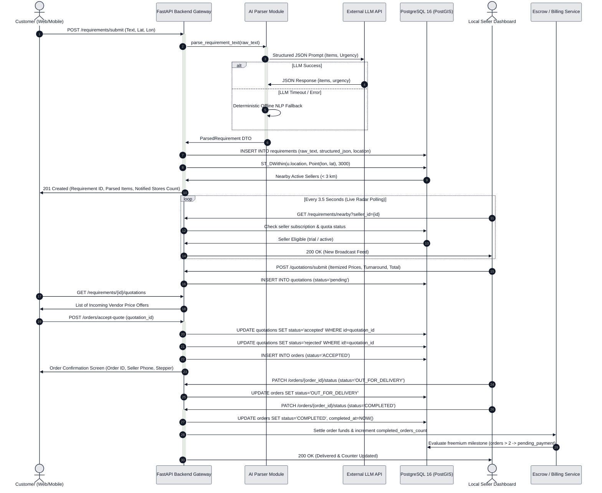

# System Architecture: Hyperlocal Reverse-Marketplace

## 1. Executive Summary & Architectural Overview

The **Hyperlocal Reverse-Marketplace** is an on-demand quick-commerce platform connecting hyperlocal consumer demand with neighborhood brick-and-mortar merchants within a strict 3-kilometer radius. 

Unlike traditional e-commerce models where customers browse pre-cataloged inventories with centralized warehousing, this system implements a **reverse-auction / demand-pull architecture**:
1. **Demand Expression**: Customers express multi-item grocery and household needs using unstructured natural language (e.g., *"Need 2 packets of whole wheat bread, 1L organic milk, and fresh bananas"*).
2. **AI Extraction**: An asynchronous AI parser extracts structured item entities, requested quantities, canonical categories, and urgency levels.
3. **Hyperlocal Radar**: PostGIS spherical spatial indexes calculate a strict 3-kilometer perimeter around customer GPS coordinates.
4. **Seller Notification & Fulfillment**: In-radius merchants with matching category stock receive live demand alerts on their dashboard radar, submit competitive itemized price quotes, and fulfill orders with doorstep delivery upon customer acceptance.

---

## 2. High-Level Multi-Tier Architecture Diagram

```mermaid
%%{init: {'theme': 'base', 'themeVariables': { 'primaryColor': '#e5e7eb', 'primaryBorderColor': '#374151', 'primaryTextColor': '#111827', 'lineColor': '#4b5563', 'edgeLabelBackground':'#ffffff', 'tertiaryColor': '#f3f4f6'}, 'flowchart': {'curve': 'linear'}}}%%
flowchart TB

    subgraph CLIENT_TIER["CLIENT APPLICATION TIER"]
        direction TB
        C_MOB["Customer Mobile App (React Native / Expo)"]
        C_WEB["Customer Web Portal (React / Tailwind CSS)"]
        S_WEB["Seller Dashboard & Radar (React / Tailwind CSS)"]
        A_WEB["Admin & Operations Console (React / Tailwind CSS)"]
    end

    subgraph GATEWAY_TIER["API & APPLICATION SERVER TIER (FastAPI)"]
        direction TB
        API_ROUTER["FastAPI Asynchronous Gateway & Router"]
        
        subgraph CORE_SERVICES["Core Application Services"]
            direction LR
            AI_MOD["AI Parser Module (Async LLM Client + Rule Fallback)"]
            GEO_MOD["Geospatial Matching Engine (3 km PostGIS Filter)"]
            ORD_MOD["Order Lifecycle & Delivery Tracker"]
            BIL_MOD["Billing, Quota & Freemium Engine"]
            INV_MOD["Inventory & Multi-Category Catalog Engine"]
        end
    end

    subgraph DATABASE_TIER["PERSISTENCE & SPATIAL DATA TIER (PostgreSQL 16)"]
        direction TB
        subgraph PG_EXTENSIONS["PostgreSQL Spatial & Semantic Engines"]
            direction LR
            POSTGIS["PostGIS 3.6 (ST_DWithin, ST_Distance, GiST Index)"]
            PGVECTOR["pgvector 0.8 (Vector Cosine Distance Embeddings)"]
        end
        subgraph PG_RELATIONAL["Relational & JSONB Storage"]
            direction LR
            TBL_USERS["users (GPS Location, Roles, Subscriptions)"]
            TBL_REQ["requirements (Raw Text, Parsed JSONB)"]
            TBL_INV["inventory_items & item_categories (Catalog)"]
            TBL_QUO["quotations (Itemized Pricing, Turnaround)"]
            TBL_ORD["orders (Lifecycle Status, Delivery Milestones)"]
        end
    end

    subgraph EXTERNAL_TIER["EXTERNAL SERVICES TIER"]
        direction TB
        EXT_LLM["LLM Provider API (Gemini / OpenAI / Anthropic)"]
        EXT_PAY["Payment Gateway & Escrow Settlement Handler"]
    end

    %% Client Tier to API Gateway (Solid Lines)
    C_MOB --> API_ROUTER
    C_WEB --> API_ROUTER
    S_WEB --> API_ROUTER
    A_WEB --> API_ROUTER

    %% API Gateway to Core Services (Solid Lines)
    API_ROUTER --> AI_MOD
    API_ROUTER --> GEO_MOD
    API_ROUTER --> ORD_MOD
    API_ROUTER --> BIL_MOD
    API_ROUTER --> INV_MOD

    %% Services to External Tier (Solid Lines)
    AI_MOD --> EXT_LLM
    BIL_MOD --> EXT_PAY
    ORD_MOD --> EXT_PAY

    %% Services to Database Tier (Solid Lines)
    GEO_MOD --> POSTGIS
    GEO_MOD --> TBL_USERS
    GEO_MOD --> TBL_INV
    AI_MOD --> PGVECTOR
    API_ROUTER --> TBL_REQ
    ORD_MOD --> TBL_ORD
    ORD_MOD --> TBL_QUO
    INV_MOD --> TBL_INV
    BIL_MOD --> TBL_USERS
```



---

## 3. Data Flow Architecture: From Customer Input to Seller Radar

The core workflow transitions through six tightly integrated stages across the client, backend, spatial database, and merchant tiers.


### Step 1: Customer Input & Coordinate Acquisition
1. The customer enters an unstructured grocery list into the natural language textarea on the **Customer Portal** or **Expo Mobile App**.
2. GPS coordinates (Latitude & Longitude) are captured via the browser's HTML5 Geolocation API or device-native mobile location hardware (with fallback presets for testing, e.g., Wakad, Pune: `18.5987, 73.7660`).
3. The client issues an HTTP `POST /requirements/submit` payload containing:
   - `customer_id`: Unique identifier (UUID).
   - `raw_text`: Natural language text string.
   - `latitude` and `longitude`: Float values adhering to WGS84 standards.

### Step 2: Asynchronous AI Parsing & Strict Schema Extraction
1. The FastAPI request pipeline invokes `ai_parser.py`.
2. The parser formats a system prompt instructing the configured LLM client (`Google Gemini`, `OpenAI`, or `Anthropic`) to extract shopping parameters into a strict Pydantic JSON schema:
   - `items`: Array of objects containing `product_name`, `quantity` (with unit), and `category`.
   - `urgency`: Categorized as `immediate` (<30 mins), `today`, or `flexible`.
   - `notes`: Any dietary or delivery constraints.
3. **Resilience & Fallback Strategy**:
   - If the external LLM provider encounters a network timeout (enforced by a 10-second `httpx` timeout) or returns unparseable tokens, an internal deterministic NLP regex parser automatically takes over, guaranteeing 100% operational availability.
4. The requirement is persisted into the PostgreSQL `requirements` table with `status = 'BROADCASTED'` and the parsed shopping list stored in a native `JSONB` column.

### Step 3: Spatial Filtering Across the 3 km PostGIS Perimeter
1. The backend triggers `matching_engine.py`, executing an indexed PostGIS query on the `users` table:
   ```sql
   SELECT u.id, u.name, u.phone, u.location,
          ST_Distance(geography(u.location), geography(ST_SetSRID(ST_MakePoint(:lon, :lat), 4326))) AS distance_meters
   FROM users u
   WHERE u.role = 'seller'
     AND ST_DWithin(
           geography(u.location),
           geography(ST_SetSRID(ST_MakePoint(:lon, :lat), 4326)),
           3000.0
         )
   ORDER BY distance_meters ASC;
   ```
2. The query leverages a **GiST (Generalized Search Tree) spatial index** on `users.location`, evaluating spherical great-circle distances across the earth's ellipsoid in sub-millisecond execution times.
3. Sellers situated beyond the 3,000-meter boundary are filtered out at the database engine level, avoiding memory-intensive application-layer distance filtering.

### Step 4: Multi-Category Catalog Matching & Ranking
1. For each active merchant identified within the 3 km radius, the matching engine cross-references the requested items against the merchant's live inventory (`inventory_items`) and associated taxonomy (`categories`, linked via `item_categories`).
2. Only items flagged with `is_available = true` are considered. Offboarded products are excluded.
3. The engine computes:
   - Match percentage (in-stock catalog items matching parsed demand).
   - Geodesic distance in meters.
   - Category overlaps.
4. Merchants are ranked primarily by fulfillment capability and secondarily by physical proximity.

### Step 5: Real-Time Radar Delivery to Seller Dashboard
1. The **Seller Dashboard** maintains a live polling cycle (every 3 to 5 seconds) against `GET /requirements/nearby?seller_id={id}`.
2. **Freemium Gating Enforcement**:
   - Before returning broadcasts, `enforce_seller_broadcast_access` checks the merchant's `completed_orders_count` and `subscription_status`.
   - If the merchant has fulfilled more than 2 trial orders without an active Rs. 1,000/month subscription, broadcast access is blocked with HTTP 403 Forbidden.
   - Subscribed merchants and active trial merchants receive the broadcast payload with full line-item details, urgency badge, and customer distance.

### Step 6: Vendor Quoting, Order Acceptance & Escrow Settlement
1. **Quotation Submission**:
   - The merchant reviews the demand and submits an itemized price quote via `POST /quotations/submit` (specifying item unit prices, delivery turnaround minutes, and total ₹ amount).
2. **Live Customer Feed**:
   - The customer's `CustomerRequirementQuotesView` auto-updates with incoming vendor bids.
3. **Acceptance & Lifecycle Transition**:
   - The customer clicks **"Accept Quote & Order"**, triggering `POST /orders/accept-quote`.
   - The chosen quotation transitions to `accepted`; competing quotes are marked `rejected`.
   - The order and requirement statuses transition to `ACCEPTED`.
4. **Doorstep Delivery & Fulfillment**:
   - The vendor updates status to `OUT_FOR_DELIVERY` upon dispatch and `COMPLETED` upon doorstep handover.
   - The live customer progress stepper updates instantaneously.
   - On completion, the seller's `completed_orders_count` increments, evaluating the freemium threshold trigger.

---

## 4. End-to-End Demand Lifecycle Sequence Diagram



---

## 5. Architectural Tier Specifications

### Tier 1: Client Application Tier
* **Customer Mobile Application**:
  * Framework: React Native / Expo.
  * Target Platforms: Android, iOS, Web.
  * Features: Native GPS capture, natural language requirement input, AI shopping summary cards, live vendor quote viewing, and delivery progress tracking.
* **Customer Web Portal**:
  * Framework: React 18 / Vite.
  * Styling: Tailwind CSS.
  * Features: Glassmorphic navigation header, preset location selector, real-time database health indicator, `CustomerRequirementQuotesView` with quote polling, and `Accept Quote` modal.
* **Seller Web Dashboard**:
  * Features: 3 km live demand radar feed, "Accept Order & Quote Price" modal, 3-tab navigation (`Live Demand Radar`, `Inventory & Catalog Management`, `Orders & Delivery Lifecycle`), real-time stock toggles, and freemium subscription banner.
* **Admin & Operations Console**:
  * Features: System-wide health checks, PostGIS spatial query diagnostics, active query inspect, and merchant subscription status monitoring.

### Tier 2: API Gateway & Application Server Tier
* **Framework**: FastAPI (Python 3.14).
* **Asynchronous Concurrency**: Built on `uvicorn` and `asyncio` for non-blocking I/O.
* **Sub-Routers & Modules**:
  * `health.py`: System diagnostic probe monitoring PostgreSQL 16, PostGIS 3.6, and pgvector 0.8 connectivity.
  * `requirements.py`: Natural language demand ingestion, AI parsing triggers, and 3 km merchant matching.
  * `quotations.py`: Vendor price offer submissions, requirement quote queries, and authorization checks.
  * `orders.py`: Order acceptance, status lifecycle transitions (`ACCEPTED`, `OUT_FOR_DELIVERY`, `COMPLETED`), and fulfillment metrics.
  * `inventory.py`: Single-item creation, bulk JSON upload, CSV file catalog parsing, and real-time stock availability toggles.
  * `billing.py`: Freemium quota tracking, 2-order trial milestone gate, and platform fee settlement.

### Tier 3: Database & Spatial Storage Tier
* **Database Engine**: PostgreSQL 16 (Debian Bookworm base container: `hyperlocal-postgres`).
* **PostGIS Extension (3.6)**:
  * Geospatial primitives: `geography(Point, 4326)` for WGS84 geodesic calculations.
  * Spatial index: GiST index on `users.location` for constant-time radius queries.
  * Spatial functions: `ST_DWithin` for boundary filtering, `ST_Distance` for exact meter calculations.
* **pgvector Extension (0.8)**:
  * Vector cosine distance operator (`<=>`) enabling semantic search between customer requirement descriptions and product catalog items.
* **Relational Schema**:
  * `users`: Stores user identity, phone, role (`customer`, `seller`, `admin`), GPS coordinates, subscription status (`trial`, `active`, `expired`), and completed order count.
  * `categories`: Normalized taxonomy tree (`category`, `sub_category`).
  * `inventory_items`: Merchant product records with pricing and stock availability.
  * `item_categories`: Many-to-many junction table associating a single product record with multiple categories without data duplication.
  * `requirements`: Customer demand logs with raw text and parsed `JSONB` parameters.
  * `quotations`: Vendor price bids linked to requirements.
  * `orders`: Fulfilled transactions with itemized billing and delivery tracking.

### Tier 4: External Services Tier
* **LLM Providers**:
  * Supported: Google Gemini (`gemini-1.5-flash`), OpenAI (`gpt-4o-mini`), Anthropic Claude (`claude-3-5-haiku`).
  * Communication: Secure asynchronous HTTPS REST calls with structured output prompts.
* **Payment & Escrow Gateway**:
  * Supported channels: Unified Payments Interface (UPI), Credit/Debit Cards, and Direct Platform Escrow.
  * Functions: Customer payment authorization, merchant escrow release, and Rs. 1,000 monthly subscription collection.

---

## 6. Technical Design Constraints & Principles

1. **Strict Spatial Determinism**: All vendor discovery is strictly governed by spherical geodesic calculations within 3,000 meters. No off-boundary merchants are ever notified.
2. **Resilient Offline Fallback**: The platform never fails if an external AI API experiences downtime. The deterministic rule parser guarantees unbroken continuity.
3. **Normalized Multi-Category Deduplication**: A single merchant product can appear across multiple hierarchical taxonomies without duplicate inventory records.
4. **Monetization & Quota Hardening**: The freemium threshold strictly transitions merchants after 2 completed trial orders, safeguarding the platform's revenue model.
5. **Architectural Simplicity & Extensibility**: High-performance asynchronous FastAPI micro-architecture allows horizontal scaling of API workers independently of the PostGIS database cluster.